# Keys Kept

**Your AI coding tool can use your API keys without ever seeing them.** A key ledger for solo developers and vibe coders: keys, env vars, and accounts in one encrypted place, with where each key is used, when it expires, and what to rotate when something leaks.

<p align="center"></p>

```sh
# Claude Code: MCP server + skill
/plugin marketplace add jwn7/vault-notes
/plugin install keys-kept@vault-notes

# Any shell: run with keys from an encrypted .env.age, no plaintext .env
npx keys-kept run -- npm run dev
```

[한국어 README](README.ko.md) · [CHANGELOG](CHANGELOG.md) · [Security](SECURITY.md)

> **Not externally reviewed.** Use it for keys you can rotate, and keep a backup. See [SECURITY.md](SECURITY.md) for the limits.

## Why another secrets tool
Password managers and team secret managers answer "where do I store this safely". The gap is what happens after: your laptop catches malware, or a key lands in a public repo, and you have to work out which keys were on that machine and where else they live.

- **It recognises keys.** Paste one and it tells you the provider, whether it is a live key, and whether it is safe to ship to a browser.
- **It catches the common mistake.** A secret key under a browser-exposed name (`NEXT_PUBLIC_`, `VITE_`, …) is flagged before you deploy it.
- **It keeps a ledger.** Each key records the project, environment, machines and services it is used in, and its expiry.
- **Incident mode.** Pick the device, service, or project that leaked and get the list of keys to rotate, with a link to each provider's rotation page.
- **Environment comparison.** Keys as rows, environments as columns. The value that exists in dev but not in prod is the one that takes production down.
- **AI tools get names, not values.** An MCP server lets a coding assistant run commands with your keys injected. The values never enter the conversation, and output is redacted.
- **No company server.** Ciphertext syncs to your own Google Drive or a folder you choose. If this project disappears, your data still opens.

## What it looks like in use
```bash
# Paste a .env into the app, then export it encrypted (a standard age file).
# Run without a plaintext .env on disk:
npx keys-kept run -- npm run dev

# Fail fast if the vault is missing something the code needs:
npx keys-kept check            # .vault.yml `required` and .env.example

# Block a commit that contains one of your actual key values:
npx keys-kept scan

# Push to GitHub Actions secrets through your own gh login:
npx keys-kept push github --repo me/app --dry-run

# Let Claude Code use keys by name (MCP server + skill):
#   /plugin marketplace add jwn7/vault-notes
#   /plugin install keys-kept@vault-notes
```
In the app, `Ctrl K`, a few letters of the key name, and `Enter` copies the value. `Shift Enter` copies `NAME=value`.

Details: [packages/env/README.md](packages/env/README.md) (run wrapper, loader, MCP server, branch-to-environment mapping), [docs/TEAM.md](docs/TEAM.md) (sharing a project with teammates by public key).

## Getting started
```bash
pnpm i
pnpm -r test            # core, web, env
pnpm --filter web dev   # http://localhost:5173
```
On first run you choose a master password and receive a 12-word recovery phrase. By default everything stays on the device (ciphertext in IndexedDB).

- **Google Drive sync:** set `VITE_GOOGLE_CLIENT_ID` in `apps/web/.env` (a web OAuth client with the `drive.file` scope), then Settings → Sync.
- **Backup:** Settings → Backup produces `vault-YYYY-MM-DD.age`. `age -d` opens it without this app.
- **Language:** Korean and English. Settings → Appearance.

## How it protects your keys
| | |
|---|---|
| Password to key | Argon2id (libsodium `crypto_pwhash`) |
| Items | XChaCha20-Poly1305, padded so sizes do not reveal length |
| Sync | Only ciphertext leaves the device. Conflicts keep both versions. A device will not accept an older version than it already holds. |
| Backups and shared files | Standard [age](https://age-encryption.org) format. Team sharing uses post-quantum hybrid recipients. |
| Web app | Content Security Policy blocks external scripts and unknown hosts. No external requests at startup. |

No cryptographic primitives are implemented in this repository. The threat model, each defence, and the limits are written up in [docs/SECURITY.md](docs/SECURITY.md) (Korean) and summarised in [SECURITY.md](SECURITY.md).

## Repository layout
```
packages/core   encryption, local store, sync engine, backup, key ledger logic (no UI; runs in browser and Node)
packages/env    npm package keys-kept: run, check, scan, push, MCP server, .vault.yml (plain JS, no build step)
plugins/        Claude Code plugin keys-kept (MCP server + skill)
apps/web        React + Vite PWA
supabase/       optional hosted backend
docs/           spec, data model, design, strategy, security, team sharing (mostly Korean)
```
Start with [docs/STRATEGY.md](docs/STRATEGY.md) for what this is and what is planned, and [CLAUDE.md](CLAUDE.md) for the working rules of the codebase.

## Status
Working: the ledger, key recognition, `.env` import and export, environment comparison, incident mode, the Node helpers, the MCP server, file-based team sharing, Drive and folder backends.

Not done: an external security review, a packaged desktop or mobile build, live shared projects for teams, OS keychain integration for the Node helpers.

## License
- **App and core** (`apps/`, `packages/core`, `supabase/`): [AGPL-3.0-only](LICENSE). You may use, study, and modify it. If you run a modified version as a network service, you must offer its source to your users.
- **`keys-kept`** (`packages/env`, the npm package) and the **Claude Code plugin** (`plugins/keys-kept`): [MIT](packages/env/LICENSE), so you can use them in any project, including commercial and closed-source ones.
- Code published before 2026-11-26 was released under MIT and stays available under MIT.

Versions and release notes: [CHANGELOG.md](CHANGELOG.md). How releases are cut: [docs/RELEASING.md](docs/RELEASING.md).
